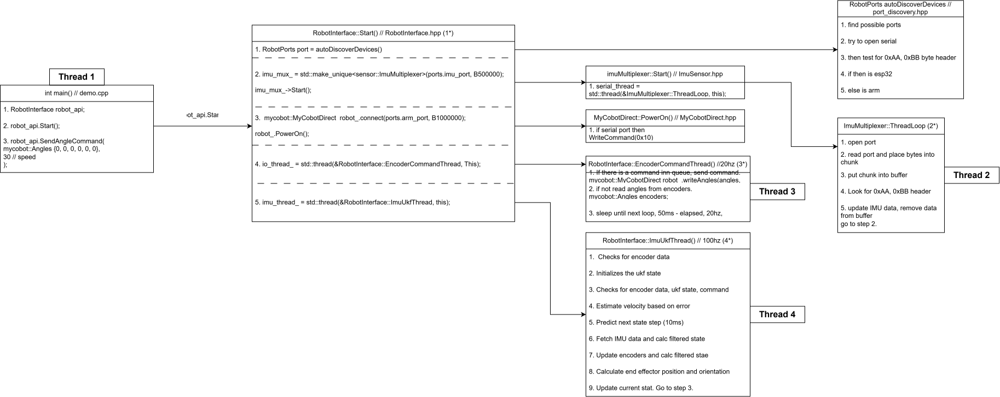

# MyCobot 280 & IMU Sensor Fusion API

## Chapter 0: Overview and Setup

### 0.0 Introduction
This library provides a C++ hardware interface and real-time state estimation API for the Elephant Robotics myCobot 280 6-DOF robotic arm and an external inertial measurement unit (IMU) sensor array. It was written and designed by Elias Ludviksson for the Nonlinear Control Lab at Columbia University under Professor Homayoon Beigi.

The core objective of this architecture is to make the real-time control loop as clean and accessible as possible for researchers and students. Low-level serial communication, thread synchronization, forward kinematics, and sensor fusion via a 12-state Unscented Kalman Filter (UKF) are handled automatically in background threads. The API exposes a simple workflow: it returns the synchronized state of the arm (`GetState()`) and accepts target state setpoints (`SendAngleCommand()`). Users can focus entirely on designing and testing top-level control algorithms such as PID, Secant (Broyden's method), Model Predictive Control (MPC), or custom nonlinear controllers via `Controllers.hpp`.

---

### 0.1 Repository File Guide (What to Focus On)
Because this repository contains experimental scripts and legacy test files, you only need to focus on a small set of core header and source files to build your controllers. Do not worry about the rest of the uncleaned workspace; these are the essential files that power the system:

*   **`RobotInterface.hpp`**: The primary entry point for the user. It manages the dual-thread execution loop (a 20Hz hardware I/O thread and a 100Hz UKF/IMU thread), houses the 12-state Unscented Kalman Filter (`ArmUKF`), computes real-time Denavit-Hartenberg Forward Kinematics, and provides thread-safe methods (`Start()`, `Home()`, `GetState()`, `SendAngleCommand()`, and `Stop()`).
*   **`MyCobotDirect.hpp`**: The low-level POSIX serial driver for the Elephant Robotics myCobot 280 M5/Jetson arm. It formats hexadecimal byte frames (`0xFE 0xFE ... 0xFA`) at a `1,000,000` baud rate to read motor encoders and write joint angle trajectories directly without external middleware overhead.
*   **`ImuSensor.hpp`**: The high-speed serial multiplexer and quaternion math engine for the ESP32 IMU array. Operating at `500,000` baud, it parses `121-byte` packed binary data frames (`0xAA 0xBB` header), verifies XOR checksums, applies physical mounting offsets, and handles dynamic quaternion taring.
*   **`port_discovery.hpp`**: An automatic hardware handshaking utility. It scans `/dev/ttyUSB*` and `/dev/ttyACM*` ports, listens for the `0xAA 0xBB` IMU header stream, and tests serial connections to automatically assign the correct file descriptors to the arm and the ESP32 IMU array.
*   **`Controllers.hpp`**: The top-level control algorithm library. It defines an abstract base `controller` class alongside ready-to-use multi-dimensional control laws, specifically a filtered `pid_controller` with tracking anti-windup and a regularized `secant` controller (Damped Least Squares).
*   **`260813_ri_test.cpp` (or `ri_test.cpp`)**: The primary reference implementation and hardware verification script. Running this executable initializes the interface, homes the robot, steps through a multi-point pan/tilt trajectory, and prints raw encoder values, UKF-filtered angles, joint velocities, and Cartesian coordinates to the terminal.

---

### 0.2 Setup, Requirements, and Compilation

#### System Requirements
1.  **Operating System**: Linux (Ubuntu 20.04 / 22.04 / 24.04 recommended) due to native POSIX `termios.h`, `fcntl.h`, and `/dev` filesystem scanning.
2.  **Compiler**: `g++` or `clang++` supporting **C++17** or newer (required for `std::filesystem` in `port_discovery.hpp`).
3.  **Eigen3 Library**: Both `RobotInterface.hpp` and `Controllers.hpp` rely heavily on the `Eigen` matrix library (`<Eigen/Dense>` and `<Eigen/Geometry>`) for state-space filtering, Cholesky decompositions, and pseudo-inverse matrix math.
4.  **POSIX Threads (`pthread`)**: Required for running the concurrent serial I/O and state estimation threads.

Install the required dependencies on Ubuntu/Debian:
```bash
sudo apt-get update
sudo apt-get install build-essential libeigen3-dev
```

#### Compiling with Eigen and Creating a Makefile
Because Eigen headers are typically installed in `/usr/include/eigen3/Eigen/...` on Linux systems, including `<Eigen/Dense>` directly in the C++ files will cause a fatal compiler error unless you explicitly pass the include path `-I/usr/include/eigen3` to `g++`.

While you can compile a single script manually from the terminal like this:
```bash
g++ -std=c++17 -O3 -I/usr/include/eigen3 260813_ri_test.cpp -o ri_test -lpthread
```

Typing that out every time is error-prone. To fix this permanently, create a `Makefile` in the root directory of your repository:

```makefile
# Compiler and Flags
CXX = g++
CXXFLAGS = -std=c++17 -O3 -Wall -Wextra -I/usr/include/eigen3 -I.
LDFLAGS = -lpthread

# Targets
TARGETS = ri_test simple_demo pid_demo secant_demo

all: $(TARGETS)

ri_test: 260813_ri_test.cpp RobotInterface.hpp MyCobotDirect.hpp ImuSensor.hpp port_discovery.hpp
	$(CXX) $(CXXFLAGS) 260813_ri_test.cpp -o ri_test $(LDFLAGS)

simple_demo: simple_demo.cpp RobotInterface.hpp
	$(CXX) $(CXXFLAGS) simple_demo.cpp -o simple_demo $(LDFLAGS)

pid_demo: pid_demo.cpp RobotInterface.hpp Controllers.hpp
	$(CXX) $(CXXFLAGS) pid_demo.cpp -o pid_demo $(LDFLAGS)

secant_demo: secant_demo.cpp RobotInterface.hpp Controllers.hpp
	$(CXX) $(CXXFLAGS) secant_demo.cpp -o secant_demo $(LDFLAGS)

clean:
	rm -f $(TARGETS)
```

> **Note on Serial Permissions**: Ensure your Linux user belongs to the `dialout` group so the program can open `/dev/ttyUSB*` and `/dev/ttyACM*` without needing `sudo`:
> ```bash
> sudo usermod -a -G dialout $USER
> ```
> *(Log out and log back in for group changes to take effect).*

---

## Chapter 1: User Guide and Code Examples

### 1.0 Intended Program Layout
Every program built with `RobotInterface.hpp` follows four foundational steps:
1.  **Instantiation & Startup**: Create a `RobotInterface` object and call `.Start()`. This discovers the USB ports, powers on the servos, launches the 20Hz and 100Hz background threads, and dynamically tares the IMUs against the starting encoder positions.
2.  **Homing (Optional but Recommended)**: Call `.Home()` or send a `{0, 0, 0, 0, 0, 0}` command to bring the arm to a known mechanical zero and re-tare the sensors.
3.  **Control Loop**: Periodically call `.GetState()` to read the latest synchronized `RobotState`, run your control math, and push new joint targets to the hardware queue via `.SendAngleCommand(target_angles, speed)`.
4.  **Graceful Shutdown**: Call `.Stop()` to join the background threads, halt motor movement, and close the serial file descriptors.

---

### 1.1 Minimal Quickstart Example: Start, Move, Read, and Stop
The following complete, runnable program (`simple_demo.cpp`) demonstrates the simplest way to initialize the arm, command a single pose, inspect the state estimate, and shut down safely.

```cpp
#include <iostream>
#include <chrono>
#include <thread>
#include <iomanip>
#include "RobotInterface.hpp"

int main() {
    // 1. Instantiate the interface
    RobotInterface robot_api;

    // 2. Discover ports, power on servos, and start 20Hz/100Hz background threads
    std::cout << "Initializing RobotInterface...\n";
    if (robot_api.Start() != 0) {
        std::cerr << "Error: Failed to start RobotInterface. Check USB connections.\n";
        return 1;
    }

    // 3. Move the arm to the mechanical home position (all joints 0 degrees)
    robot_api.Home();

    // 4. Define a target joint configuration in degrees: {J1, J2, J3, J4, J5, J6}
    mycobot::Angles target_pose = {45.0, -30.0, 30.0, 0.0, 45.0, 0.0};
    int movement_speed = 25; // Speed percentage (1 to 100)

    std::cout << "Sending target angles: [45.0, -30.0, 30.0, 0.0, 45.0, 0.0] at speed " 
              << movement_speed << "...\n";
    robot_api.SendAngleCommand(target_pose, movement_speed);

    // Wait 4 seconds for the physical movement to complete and the UKF to settle
    std::this_thread::sleep_for(std::chrono::milliseconds(4000));

    // 5. Fetch the synchronized state struct from the 100Hz UKF thread
    RobotState current_state = robot_api.GetState();

    std::cout << std::fixed << std::setprecision(2);
    std::cout << "\n--- Synchronized Robot State ---\n";
    std::cout << "Raw Encoders (deg): [" 
              << current_state.raw_encoders[0] << ", " << current_state.raw_encoders[1] << ", "
              << current_state.raw_encoders[2] << ", " << current_state.raw_encoders[3] << ", "
              << current_state.raw_encoders[4] << ", " << current_state.raw_encoders[5] << "]\n";

    std::cout << "UKF Filtered (deg): [" 
              << current_state.ukf_angles[0] << ", " << current_state.ukf_angles[1] << ", "
              << current_state.ukf_angles[2] << ", " << current_state.ukf_angles[3] << ", "
              << current_state.ukf_angles[4] << ", " << current_state.ukf_angles[5] << "]\n";

    std::cout << "End-Effector Pos:   X=" << current_state.cartesian_pos.x() << "m, "
              << "Y=" << current_state.cartesian_pos.y() << "m, "
              << "Z=" << current_state.cartesian_pos.z() << "m\n";

    // 6. Return to zero and safely shut down threads and serial ports
    std::cout << "\nReturning home and stopping...\n";
    mycobot::Angles zero_pose = {0.0, 0.0, 0.0, 0.0, 0.0, 0.0};
    robot_api.SendAngleCommand(zero_pose, 30);
    std::this_thread::sleep_for(std::chrono::milliseconds(3500));

    robot_api.Stop();
    std::cout << "Shutdown complete.\n";

    return 0;
}
```

#### Line-by-Line Breakdown of Key Calls
*   `RobotInterface robot_api;`: Constructs the interface object and initializes internal mutexes and the `ArmUKF` filter state matrices.
*   `robot_api.Start()`: Scans `/dev/` for the arm and ESP32 IMU ports, configures mounting quaternions, powers on the robot, starts `EncoderCommandThread` (20Hz) and `ImuUkfThread` (100Hz), and performs a dynamic quaternion tare based on the first valid encoder reading.
*   `robot_api.SendAngleCommand(target_pose, movement_speed)`: Thread-safely pushes a `MotorCommand` struct onto `command_queue_`. It does not block your main loop; the 20Hz I/O thread pops and transmits the command over the serial bus on its next cycle.
*   `RobotState current_state = robot_api.GetState()`: Locks `state_mutex_` briefly to return a copy of the latest state, including `raw_encoders`, `ukf_angles`, `joint_velocities`, `raw_imu_q2`, `raw_imu_q5`, `cartesian_pos`, and `cartesian_orientation`.
*   `robot_api.Stop()`: Signals `keep_running_ = false`, joins both worker threads, sends hardware stop command `0x34` to the servos, and closes all serial file descriptors.

---

### 1.2 Trajectory Sweeps and Verification (`260813_ri_test.cpp`)
Included in the repository is `260813_ri_test.cpp` (often compiled as `ri_test`). This script serves as both a hardware demo that physically moves the arm through a grid of configurations and a verification benchmark for the 12-state Unscented Kalman Filter.

Specifically, `260813_ri_test.cpp` executes a nested loop over 7 pan angles (`J1`: `0.0°` to `168.0°`) and 3 tilt angles (`J2`: `0.0°`, `30.0°`, `60.0°`), commanding the arm to 21 distinct spatial poses:

```cpp
// Excerpt from 260813_ri_test.cpp: Nested trajectory sweep
std::vector<double> pan_angles = {0.0, 30.0, 60.0, 90.0, 120.0, 150.0, 168.0};
std::vector<double> tilt_angles = {0.0, 30.0, 60.0};

for (double pan : pan_angles) {
    for (double tilt : tilt_angles) {
        mycobot::Angles target = {pan, tilt, 0, 0, 0, 0};

        // Queue the command asynchronously at speed 20
        robot_api.SendAngleCommand(target, 20);

        // Wait 3000ms for movement to finish and the UKF filter to settle
        std::this_thread::sleep_for(std::chrono::milliseconds(3000));

        // Fetch the synchronized state and compare Raw Encoders vs UKF Angles
        RobotState state = robot_api.GetState();
        std::cout << "Target [J1, J2]: [" << pan << ", " << tilt << "]\n";
        std::cout << "  Raw Encoders: [" << state.raw_encoders[0] << ", " << state.raw_encoders[1] << " ...]\n";
        std::cout << "  UKF Angles:   [" << state.ukf_angles[0]   << ", " << state.ukf_angles[1]   << " ...]\n";
        std::cout << "  Cartesian X:   " << state.cartesian_pos.x() << " meters\n";
    }
}
```
Running `./ri_test` is the recommended first step whenever setting up the hardware to verify that serial communication, IMU alignment, and forward kinematics are functioning properly.

---

### 1.3 Implementing Closed-Loop Control with `Controllers.hpp`
When designing closed-loop controllers using `Controllers.hpp` (such as `pid_controller` or `secant`), it is important to understand the physical units and safety limits of the arm:
*   **Unit Conversion (Radians vs. Degrees)**: The top-level controllers in `Controllers.hpp` are tuned to operate in **radians** and output optimal joint velocities in **radians per second (rad/s)**. In contrast, `RobotInterface` reports joint angles and accepts angle commands in **degrees** (`mycobot::Angles`).
*   **Velocity Caps**: Each joint velocity output is clamped to `[-1.5, 1.5]` rad/s via `controller::min_max` boundaries.
*   **Hard Joint Position Limits**: In radians, joint commands are clamped within `[-3.14, 3.14]` rad (`[-180.0°, 180.0°]`). Note that in practice on the physical myCobot 280 hardware, Joint 1 (`pan`) is typically operated within `[-168.0°, 168.0°]` to prevent mechanical self-collision.
*   **Velocity Integration**: Because the controllers output a velocity command $u(t)$ in rad/s, we numerically integrate that velocity over the control loop timestep $T_s = 0.1\text{ s}$ (10Hz):
    $$\theta_{\text{cmd}}[k] = \theta_{\text{cmd}}[k-1] + u[k] \cdot T_s$$
    before converting from radians to degrees and calling `SendAngleCommand()`.

#### Example A: Closed-Loop Multi-DOF PID Controller (`pid_demo.cpp`)
This complete, runnable program implements a 10Hz closed-loop PID position controller using `pid_controller` from `Controllers.hpp` and `RobotInterface.hpp`.

```cpp
#include <iostream>
#include <vector>
#include <chrono>
#include <thread>
#include <cmath>
#include <algorithm>
#include <iomanip>

#include "RobotInterface.hpp"
#include "Controllers.hpp"

constexpr double DEG_TO_RAD = M_PI / 180.0;
constexpr double RAD_TO_DEG = 180.0 / M_PI;

int main() {
    RobotInterface robot_api;

    if (robot_api.Start() != 0) {
        std::cerr << "Failed to start RobotInterface.\n";
        return 1;
    }

    // Start from home position
    robot_api.Home();

    // 1. Configure PID Controller:
    // K=0.5, Ti=0.0 (disabled integral), Td=0.075, N=10.0, b=1.0, Tt=0.5, Ts=0.1s (10Hz)
    double Ts = 0.1;
    pid_controller my_pid(0.5, 0.0, 0.075, 10.0, 1.0, 0.5, Ts);

    // 2. Define Velocity Safety Caps: [-1.5, 1.5] rad/s for all 6 joints
    std::vector<controller::min_max> velocity_bounds = {
        {-1.5, 1.5}, {-1.5, 1.5}, {-1.5, 1.5},
        {-1.5, 1.5}, {-1.5, 1.5}, {-1.5, 1.5}
    };

    // 3. Define Target Setpoint in Radians (e.g., J1 = 1.0 rad (~57.3 deg), J2 = 0.5 rad (~28.6 deg))
    std::vector<double> target_pos_rad = {1.0, 0.5, -0.5, 0.0, 0.5, 0.0};

    // Fetch initial state from the UKF and convert to radians
    RobotState init_state = robot_api.GetState();
    std::vector<double> current_meas_rad(6, 0.0);
    for (size_t i = 0; i < 6; ++i) {
        current_meas_rad[i] = init_state.ukf_angles[i] * DEG_TO_RAD;
    }

    // Initialize the PID system
    my_pid.init_system(current_meas_rad, target_pos_rad, velocity_bounds);
    my_pid.update_setpoints(target_pos_rad);

    // Track integrated position command in radians
    std::vector<double> current_cmd_pos_rad = current_meas_rad;

    std::cout << "Starting 10Hz PID Control Loop for 10 seconds (100 iterations)...\n";

    // 4. Run 10Hz Control Loop (Ts = 100ms)
    for (int step = 0; step < 100; ++step) {
        auto loop_start = std::chrono::steady_clock::now();

        // A. Read synchronized UKF state from RobotInterface
        RobotState state = robot_api.GetState();
        for (size_t i = 0; i < 6; ++i) {
            current_meas_rad[i] = state.ukf_angles[i] * DEG_TO_RAD;
        }

        // B. Update controller measurements and compute optimal velocity commands (rad/s)
        my_pid.update_system(current_meas_rad);
        my_pid.compute();
        std::vector<double> vel_commands_rad_s = my_pid.getOutputs();

        // C. Integrate velocity into position command and clamp to [-3.14, 3.14] rad
        mycobot::Angles cmd_deg;
        for (size_t i = 0; i < 6; ++i) {
            current_cmd_pos_rad[i] = current_cmd_pos_rad[i] + (vel_commands_rad_s[i] * Ts);
            current_cmd_pos_rad[i] = std::max(-3.14, std::min(current_cmd_pos_rad[i], 3.14));

            // Convert integrated radian command to degrees for RobotInterface
            // Also clamp to +/- 168.0 deg to respect physical myCobot 280 limits
            double deg = current_cmd_pos_rad[i] * RAD_TO_DEG;
            cmd_deg[i] = std::max(-168.0, std::min(deg, 168.0));
        }

        // D. Send command to hardware queue
        robot_api.SendAngleCommand(cmd_deg, 50);

        // Log progress every 5 steps (500ms)
        if (step % 5 == 0) {
            double j1_err_rad = target_pos_rad[0] - current_meas_rad[0];
            std::cout << std::fixed << std::setprecision(3)
                      << "[Step " << std::setw(2) << step << "] "
                      << "J1 Cmd: " << current_cmd_pos_rad[0] << " rad (" << cmd_deg[0] << " deg) | "
                      << "Target: " << target_pos_rad[0] << " rad | "
                      << "Error: " << j1_err_rad << " rad\n";
        }

        // Maintain 10Hz loop rate (100ms)
        std::this_thread::sleep_until(loop_start + std::chrono::milliseconds(100));
    }

    std::cout << "PID trajectory complete. Homing and shutting down...\n";
    robot_api.Home();
    robot_api.Stop();
    return 0;
}
```

#### Example B: Closed-Loop Adaptive Secant Controller (`secant_demo.cpp`)
The `secant` controller in `Controllers.hpp` implements an online multi-dimensional Broyden-like secant update rule that estimates the system Jacobian matrix $\hat{S}$ in real time and computes control velocities using Damped Least Squares regularization:
$$u_k = K_p \left(\hat{S}_k^T \hat{S}_k + \lambda I\right)^{-1} \hat{S}_k^T e_k$$

Below is a complete, runnable example showing how to swap in the `secant` controller with `RobotInterface.hpp`:

```cpp
#include <iostream>
#include <vector>
#include <chrono>
#include <thread>
#include <cmath>
#include <algorithm>
#include <iomanip>

#include "RobotInterface.hpp"
#include "Controllers.hpp"

constexpr double DEG_TO_RAD = M_PI / 180.0;
constexpr double RAD_TO_DEG = 180.0 / M_PI;

int main() {
    RobotInterface robot_api;

    if (robot_api.Start() != 0) {
        std::cerr << "Failed to start RobotInterface.\n";
        return 1;
    }

    robot_api.Home();

    // 1. Instantiate Secant Controller (default learning rate eta = 0.1)
    secant my_secant_controller(0.1);
    double Ts = 0.1; // 10Hz control period

    // 2. Define Velocity Safety Caps (rad/s)
    std::vector<controller::min_max> velocity_bounds = {
        {-1.5, 1.5}, {-1.5, 1.5}, {-1.5, 1.5},
        {-1.5, 1.5}, {-1.5, 1.5}, {-1.5, 1.5}
    };

    // 3. Target Setpoints in Radians
    std::vector<double> target_pos_rad = {-0.8, 0.4, 0.3, 0.0, -0.4, 0.0};

    RobotState init_state = robot_api.GetState();
    std::vector<double> current_meas_rad(6, 0.0);
    for (size_t i = 0; i < 6; ++i) {
        current_meas_rad[i] = init_state.ukf_angles[i] * DEG_TO_RAD;
    }

    my_secant_controller.init_system(current_meas_rad, target_pos_rad, velocity_bounds);
    my_secant_controller.update_setpoints(target_pos_rad);

    std::vector<double> current_cmd_pos_rad = current_meas_rad;

    std::cout << "Starting 10Hz Secant Control Loop...\n";

    for (int step = 0; step < 100; ++step) {
        auto loop_start = std::chrono::steady_clock::now();

        RobotState state = robot_api.GetState();
        for (size_t i = 0; i < 6; ++i) {
            current_meas_rad[i] = state.ukf_angles[i] * DEG_TO_RAD;
        }

        // Update system state and compute optimal joint velocities via Damped Least Squares
        my_secant_controller.update_system(current_meas_rad);
        my_secant_controller.compute();
        std::vector<double> commands_rad_s = my_secant_controller.getOutputs();

        // Integrate velocities and apply safety limits
        mycobot::Angles cmd_deg;
        for (size_t i = 0; i < 6; ++i) {
            current_cmd_pos_rad[i] = current_cmd_pos_rad[i] + (commands_rad_s[i] * Ts);
            current_cmd_pos_rad[i] = std::max(-3.14, std::min(current_cmd_pos_rad[i], 3.14));

            double deg = current_cmd_pos_rad[i] * RAD_TO_DEG;
            cmd_deg[i] = std::max(-168.0, std::min(deg, 168.0));
        }

        robot_api.SendAngleCommand(cmd_deg, 50);

        if (step % 5 == 0) {
            std::cout << std::fixed << std::setprecision(3)
                      << "[Step " << std::setw(2) << step << "] "
                      << "J1 Cmd: " << current_cmd_pos_rad[0] << " rad | "
                      << "J1 Measured (UKF): " << current_meas_rad[0] << " rad | "
                      << "Error: " << (target_pos_rad[0] - current_meas_rad[0]) << " rad\n";
        }

        std::this_thread::sleep_until(loop_start + std::chrono::milliseconds(100));
    }

    std::cout << "Secant control complete. Returning home...\n";
    robot_api.Home();
    robot_api.Stop();
    return 0;
}
```

---

## Chapter 2: System Architecture and Deep-Dive



### 2.0 Architectural Overview
The `RobotInterface` architecture decouples slow, blocking hardware serial operations from fast, deterministic state estimation. As illustrated in `flowchart.svg` above, when the user invokes `Start()`, the system spawns three asynchronous execution pipelines that communicate via mutex-protected shared memory and lock-free `std::atomic` variables:
1.  **The IMU Multiplexer Serial Thread (`ImuSensor.hpp`)**: Continuously reads raw 121-byte sensor packets from the ESP32 at `500,000` baud.
2.  **The Slow Hardware I/O Thread (`EncoderCommandThread` at 20Hz)**: Polls the myCobot 280 servo encoders and dispatches queued motor angle commands at `1,000,000` baud.
3.  **The Fast Sensor Fusion Thread (`ImuUkfThread` at 100Hz)**: Predicts arm motion, fuses high-rate IMU quaternions with low-rate encoder measurements via the 12-state Unscented Kalman Filter (`ArmUKF`), computes Forward Kinematics, and updates `current_state_`.

---

### 2.1 Automatic Hardware Discovery (`port_discovery.hpp`)
Linux dynamically assigns device nodes (`/dev/ttyUSB0`, `/dev/ttyACM0`, etc.) based on plug-in order. To prevent hardcoded port failures, `RobotInterface::Start()` calls `autoDiscoverDevices()` first:
*   **Filesystem Scan**: Iterates through `/dev` using `std::filesystem::directory_iterator("/dev")` to collect all candidate paths starting with `ttyUSB` or `ttyACM`.
*   **Fast IMU Stream Detection**: Opens each candidate port at `B500000` baud for up to `800ms` (`port_discovery.hpp`, lines 56-68) and scans the incoming byte stream for the 2-byte synchronization header `0xAA 0xBB`. If found, the port is assigned to `found_ports.imu_port`.
*   **MyCobot Verification**: If `0xAA 0xBB` is not detected, it tests the port at `B1000000` baud using `MyCobotDirect::Connect()` and assigns it to `found_ports.arm_port`.

---

### 2.2 Pre-Computed Denavit-Hartenberg Kinematics (`RobotInterface.hpp`)
Because the 12-state UKF generates $2L + 1 = 25$ sigma points during every 100Hz IMU update cycle, computing trigonometric functions (`sin` and `cos`) on constant link parameters $\alpha_i$ would waste CPU cycles.

In `RobotInterface.hpp` (lines 27-44), the standard Denavit-Hartenberg (DH) parameters for the myCobot 280 are stored in a `constexpr DHLink LINKS[6]` table where $\cos(\alpha_i)$ (`ca`) and $\sin(\alpha_i)$ (`sa`) are pre-computed at compile time:

| Joint | $\cos(\alpha)$ (`ca`) | $\sin(\alpha)$ (`sa`) | Link Length $a$ (m) | Link Offset $d$ (m) | $\theta_{\text{offset}}$ (rad) |
| :--- | :--- | :--- | :--- | :--- | :--- |
| **J1** | `0.0` | `1.0` | `0.0` | `0.13122` | `0.0` |
| **J2** | `1.0` | `0.0` | `-0.1104` | `0.0` | $-\pi / 2$ |
| **J3** | `1.0` | `0.0` | `-0.096` | `0.0` | `0.0` |
| **J4** | `0.0` | `1.0` | `0.0` | `0.0634` | $-\pi / 2$ |
| **J5** | `0.0` | `-1.0` | `0.0` | `0.07505` | $+\pi / 2$ |
| **J6** | `1.0` | `0.0` | `0.0` | `0.0456` | `0.0` |

*   **`GetTransform(double q_deg, const DHLink& link)` (lines 46-58)**: Converts the joint angle $q_{\text{deg}}$ to radians, adds `theta_offset`, and constructs the $4 \times 4$ homogeneous transformation matrix $T_i^{i-1}(\theta_i)$.
*   **`ComputeDhQuaternion2(q1_deg, q2_deg)` (lines 60-76)**: Computes the forward kinematic rotation up to Link 2 ($T_0^2 = T_0^1 T_1^2$), extracts its $3 \times 3$ rotation block as a unit quaternion $q_{\text{curr}}$, and computes the relative rotation from the home pose ($q_{\text{rel}} = q_{\text{curr}} \otimes q_{\text{home}}^*$). It also enforces positive scalar hemisphere (`if (q_rel.w() < 0.0) q_rel.coeffs() *= -1.0`) to prevent quaternion double-cover sign flips.
*   **`ComputeDhQuaternion5(enc_deg)` (lines 78-100)**: Chains the first five link transforms ($T_0^5 = T_0^1 T_1^2 T_2^3 T_3^4 T_4^5$) to predict the orientation of the second IMU mounted at Joint 5 relative to the home configuration.
*   **`ForwardKinematics(q_deg)` (lines 102-106)**: Chains all six transformations ($T_0^6$) to compute the 3D Cartesian position and orientation of the end-effector flange.

---

### 2.3 12-State Unscented Kalman Filter (`ArmUKF` in `RobotInterface.hpp`)
The `ArmUKF` class (lines 130-285) estimates a 12-dimensional state vector $x \in \mathbb{R}^{12}$ with state covariance $P \in \mathbb{R}^{12 \times 12}$:
$$x = \begin{bmatrix} \theta_1, \dots, \theta_6, & \dot{\theta}_1, \dots, \dot{\theta}_6 \end{bmatrix}^T$$
where $x_{0..5}$ are the 6 joint angles (in degrees) and $x_{6..11}$ are the 6 joint angular velocities (in deg/s).

#### 1. Prediction Step (`Predict(dt, u_cmd)`, lines 144-166)
Executed at 100Hz ($dt = 0.01\text{ s}$). First, it blends the current velocity state with the estimated commanded velocity $u_{\text{cmd}}$ using an exponential smoothing factor:
$$x_{i+6} \leftarrow 0.2 \, x_{i+6} + 0.8 \, u_{\text{cmd}}(i)$$
Next, it constructs the $12 \times 12$ state transition matrix $F$ with $dt$ in the upper-right $6 \times 6$ block ($F_{i, i+6} = dt$) so that position integrates velocity ($x_i \leftarrow x_i + x_{i+6} \cdot dt$), and propagates the state and covariance:
$$x \leftarrow F x, \quad P \leftarrow F P F^T + Q \quad \text{where } Q = 0.05 \cdot I_{12 \times 12}$$

#### 2. Non-Linear IMU Measurement Update (`UpdateIMU(imu2_quat, imu5_quat)`, lines 169-227)
Executed every 10ms (100Hz) with state dimension $L = 12$ and measurement dimension $M = 8$ (two 4-element quaternions from IMU 2 and IMU 5):
*   **Sigma Point Generation**: Computes the Cholesky square root $S = \text{chol}\left((L + \lambda) P\right)$ via `.llt().matrixL()` and generates $2L + 1 = 25$ sigma points $\mathcal{X}_i$.
*   **Nonlinear Measurement Model**: Passes each sigma point through `MeasurementModelIMU()` (lines 288-297), which invokes `ComputeDhQuaternion2()` and `ComputeDhQuaternion5()` to predict the expected quaternions $\mathcal{Z}_i \in \mathbb{R}^8$.
*   **Hemisphere Alignment (Antipodal Flip Protection)**: Because quaternions $q$ and $-q$ represent the exact same 3D rotation, subtracting them directly in Euclidean space during covariance calculation would corrupt the filter if a sigma point crosses the hemisphere boundary. Lines 197-200 and 221-222 check the dot product against the mean quaternion (`dot(...) < 0`) and negate the quaternion components if they lie in the opposite hemisphere.
*   **Kalman Gain & Update**: Computes innovation covariance $P_{zz}$ (with measurement noise $R_{\text{IMU}} = 0.05 \cdot I_{8 \times 8}$) and cross-covariance $P_{xz}$, solves $K = P_{xz} P_{zz}^{-1}$, and updates $x$ and $P$.

#### 3. Linear Encoder Measurement Update (`UpdateEncoders(encoders)`, lines 229-275)
Executed asynchronously at 20Hz whenever `EncoderCommandThread` raises `new_encoder_data_ready_`. Here, $M = 6$ (the 6 joint angles), and the measurement model simply extracts the first 6 elements of each sigma point (`Z.col(i) = X.col(i).head<6>()`). Because physical servo encoders provide direct angular position measurements with zero drift, a tighter measurement noise covariance $R_{\text{enc}} = 0.01 \cdot I_{6 \times 6}$ is applied.

---

### 2.4 Dual-Thread Synchronization and Timing (`RobotInterface.hpp`)
Inside `RobotInterface`, two worker threads run in parallel alongside the IMU serial multiplexer:

#### Slow Thread: `EncoderCommandThread()` (20Hz / 50ms period, lines 328-374)
The myCobot 280 serial bus is half-duplex and blocking. Polling encoders takes up to `25ms`. Running this inside the fast filter thread would stall IMU integration. Instead, `EncoderCommandThread()` runs on a `50ms` cycle:
1.  **Read First**: Calls `robot_.GetAngles(encoders)`. If valid, it locks `encoder_mutex_`, copies the readings into `latest_encoders_`, and sets `new_encoder_data_ready_ = true`.
2.  **Write Second**: Locks `queue_mutex_`. If the user has queued a trajectory point via `SendAngleCommand()`, it pops the front `MotorCommand`, sends it to the physical servos via `robot_.WriteAngles()`, updates `target_angles_` and `target_speed_` under `target_state_mutex_`, and sets the atomic flag `active_command_ = true`.
3.  **Hybrid Sleep/Spin-Wait**: Sleeps until `2ms` before the `50ms` deadline (`std::this_thread::sleep_until(next_time - 2ms)`), then busy-spins (`while (now < next_time) {}`) to achieve microsecond-accurate 20Hz framing without OS scheduler jitter.

#### Fast Thread: `ImuUkfThread()` (100Hz / 10ms period, lines 377-492)
1.  **Encoder Handshake**: Checks `new_encoder_data_ready_` under `encoder_mutex_`. On the very first encoder reading after startup (`!is_initialized_`, lines 469-479), it seeds the UKF state vector via `ukf_filter_.InitState(enc_copy)` and sets `is_initialized_ = true`.
2.  **Control Input Velocity Estimation (`u_cmd_vel`, lines 413-444)**: When `active_command_` is true, the thread estimates the instantaneous joint velocities being executed by the MyCobot internal controller. It computes the maximum joint error $\text{max err} = \max_i |\theta_{\text{target}, i} - \theta_{\text{ukf}, i}|$. Using the MyCobot 280 maximum joint speed specification of $160^\circ/\text{s}$, it scales the speed percentage:
   $v_{\max} = \left(\frac{\text{safe\_speed}}{100.0}\right) \times 160.0^\circ/\text{s}, \quad t_{\text{est}} = \frac{\text{max\_err}}{v_{\max}}, \quad u_{\text{cmd\_vel}}(i) = \frac{\text{error}_i}{t_{\text{est}}}$
   Once $\text{max err} \le 1.0^\circ$, it clears `active_command_ = false`.
3.  **Sensor Fusion & Kinematics (lines 447-468)**: Reads the latest aligned quaternions `q_imu2` and `q_imu5` from `imu_mux_`, runs `Predict(dt, u_cmd_vel)` and `UpdateIMU(q_imu2, q_imu5)` every 10ms, and runs `UpdateEncoders(enc_copy)` whenever a fresh 20Hz encoder frame arrives. Finally, it computes `ForwardKinematics()` and updates `current_state_` under `state_mutex_`.

#### Dynamic IMU Taring (`Start()`, lines 546-559)
IMUs initialize their orientation relative to an arbitrary power-on frame. If the robot arm is powered on in a non-zero posture, zero-taring the IMUs would introduce a permanent rotational offset. During `Start()`, once the first encoder packet arrives, `RobotInterface` calculates the exact expected DH quaternions (`expected_q2` and `expected_q5`) for that starting posture and calls `TareQuat()`:
$$q_{\text{tare}} = q_{\text{raw}} \otimes q_{\text{expected}}^{-1}$$
This immediately aligns both IMUs with the robot's kinematic frame regardless of the arm's initial pose.

---

### 2.5 Low-Level Serial Drivers (`ImuSensor.hpp` and `MyCobotDirect.hpp`)

#### `ImuSensor.hpp`: High-Speed Packet Framing and Mounting Compensation
*   **Binary Protocol (`lines 18-30`)**: Uses `#pragma pack(push, 1)` to define a 121-byte `ImuDataPacket` containing a 2-byte header (`0xAA 0xBB`), a 4-byte `uint32_t` timestamp, an array of three 38-byte `SensorData` structs (each holding `double quat[4]`, `float linAcc[3]`, `float gravity[3]`, and `uint8_t calibration`), and a 1-byte XOR checksum.
*   **Ring Buffer & Checksum (`ThreadLoop()`, lines 265-359)**: Reads raw bytes into a 1024-byte sliding buffer, scans for `0xAA 0xBB`, aligns the frame using `memmove`, and validates the XOR checksum (`CalculateChecksum`) over the payload before atomically updating `imu_array[0..2]`.
*   **Coordinate Frame Conjugation (`GetAlignedQuaternion()`, lines 149-177)**: Because the physical IMU PCBs are mounted at specific orientations on Links 2 and 5 (configured via `SetMountingRotation()` in `Start()`), the relative rotation in sensor space ($q_{\text{rel}} = q_{\text{tare}}^{-1} \otimes q_{\text{raw}}$) is transformed into the robot's DH link frame via quaternion conjugation:
    $$q_{\text{aligned}} = q_{\text{mount}} \otimes q_{\text{rel}} \otimes q_{\text{mount}}^{-1}$$

#### `MyCobotDirect.hpp`: Direct Hex Protocol Driver
*   **Frame Construction (`WriteCommand()`, lines 30-39)**: Wraps commands in the Elephant Robotics serial frame: `[0xFE, 0xFE, Length, Command_ID, ...Data..., 0xFA]`.
*   **Fixed-Point Angle Encoding (`GetAngles()` & `WriteAngles()`, lines 173-208)**: Command `0x20` requests encoder angles, returning 12 bytes (six big-endian `int16_t` values) which are divided by `100.0` to yield degrees. Command `0x22` multiplies target floating-point angles by `100`, packs them as high/low byte pairs alongside a 1-byte speed parameter, and writes them to the serial descriptor.

---

## Chapter 3: Future Work and Roadmap

### 3.0 Integrating the 3rd IMU and Mobile Platform Expansion
While the current implementation of `RobotInterface.hpp` and `ArmUKF` is designed specifically for a stationary 6-DOF robotic arm using two active IMUs (`imu_array[0]` at Link 2 and `imu_array[1]` at Link 5), the underlying hardware and serial architecture has already been built to support a **3rd IMU**.

As seen in `ImuSensor.hpp` (lines 27 and 343), the binary packet structure (`SensorData sensors[3]`) and the multiplexer array (`std::array<ImuState, 3> imu_array`) already parse and store real-time data from a third inertial sensor (`imu_array[2]`) at 100Hz.

Work is currently underway to integrate this 3rd IMU directly into the state estimation vector and kinematic chain. The overarching goal of this expansion is to mount the myCobot 280 arm onto an autonomous **mobile platform (mobile manipulator)**:
*   **Current State**: Assumes the base link (`Link 0`) is rigidly fixed to an inertial table frame, using 2 IMUs + 6 joint encoders to estimate the 12-state arm vector.
*   **In-Progress Mobile Manipulation Upgrade**: The 3rd IMU will track the 3D orientation and linear acceleration of the moving mobile base (or end-effector), expanding the UKF state vector and DH kinematic chain to compensate for base pitch, roll, yaw, and platform acceleration in real time while the robot drives and manipulates objects simultaneously.!]
